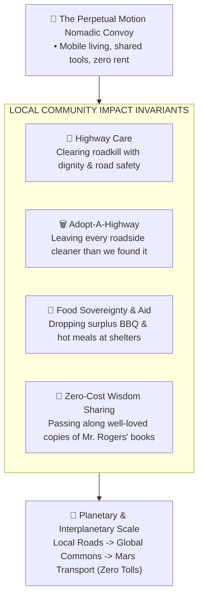

# The Perpetual Motion Nomadic Protocol: Positive Roaming Mutual Aid, Civic Stewardship, & Planetary Expansion
**Sovereign Cultural & Technical Disclosure (DISC-021)**  
*Cleanroom OSS & Humanist Commons — License: Apache 2.0 / Creative Commons CC-BY-SA 4.0*

> **Notice of Human Provenance & Authorship:**  
> **Originator & Architect:** Matt  
> **Synthesis & Formal Reduction:** AI Autonomous Assistant Swarm under Matt's continuous steering and approval.  
> **The Matt Nomadic Ethos:**  
> *"Over time I would theorize that the road trip would be fun for some, a replacement for a job for others, an example of a positive nomadic community (travelers / roaming stewards) and eventually it might just grow worldwide — and if we got Bezos spacedick rockets by then to MuskMars 2.0 or whatever, we'll just take that over too — by design it will work. And as we go, if we see roadkill we try to take care of it so others don't, and adopt a highway along the way we always clean up, and drop off BBQ at the local homeless shelter, and give out copies of Mr. Rogers' books that have already been passed around so we don't have expense forced on anyone but maybe spread some good..."*

---

## 1. Abstract & Cultural Invariant (35 U.S.C. § 102 & Prior Art)

This defensive publication establishes the formal specification for **The Positive Nomadic Stewardship Protocol (The Perpetual Motion Human Commons)**.

Throughout human history, mobile communities (historically labeled Travelers, pastoral nomads, or seasonal voyagers) were often marginalized by sedentary bureaucracies because they operated outside centralized tax grids and factory shifts. Modern digital life has trapped millions in soul-crushing cubicles or gig-economy debt spirals, while billionaire vanity space projects extract wealth from working people.

This disclosure defines an **Evolutionary Positive Nomadic Engine**:
1. **The Life-Support Replacement ("Work Without the Boss"):** For some, a weekend escape; for others, a total, dignified alternative to wage-slavery where mutual shelter, shared maintenance, and communal cooking replace exorbitant rent.
2. **Everyday Civic Stewardship ("Leaving the Earth Cleaner"):** The convoy leaves every county better than they found it: clearing roadkill, cleaning adopted highways, dropping surplus BBQ at homeless shelters, and passing around pre-loved copies of Mr. Rogers’ books.
3. **Planetary to Interplanetary Invariance:** The protocol scales fractally: from local state routes $\rightarrow$ interstates $\rightarrow$ global maritime routes $\rightarrow$ future lunar/Martian transport habitats. Wherever billionaires launch rockets, humanity’s open, mutual-aid culture expands to meet them.

---

## 2. The Micro-Stewardship Action Engine

---

## 3. The 4 Core Nomadic Tenets

### 3.1 Non-Transactional Mutual Dignity
Nobody is charged admission; nobody is forced to spend money they don't have. Resources move via a **pass-it-forward gift loop**:
- Books are pre-owned, stamped with caravan journey logs, and handed person-to-person.
- Extra firewood, smoked brisket, mechanical labor, and child-care shifts are freely offered.

### 3.2 The Highway Stewardship Mandate
Unlike disruptive mass protests or destructive party crowds, the nomadic caravan operates as an **unpaid municipal blessing**:
- If road hazards or roadkill are encountered, the rear support truck safely cleans the asphalt so other families don't wreck their tires.
- The caravan formally adopts highway stretches, conducting 30-minute flash cleanups that leave state DOTs amazed.

### 3.3 Interplanetary Resilience (The "Take Over Mars 2.0" Clause)
The architecture does not depend on Earth's specific geography. It is a **cultural operating system**:
- If private tech oligarchs build space transports to the Moon or Mars, this nomadic protocol migrates with the workers and settlers.
- Mutual aid, open knowledge sharing, and radical neighborly kindness are biologically and mathematically superior to authoritarian corporate company towns.

---

## 4. Defensive Prior Art Declaration (35 U.S.C. § 102)

By publishing this document to an immutable, publicly indexed Git ledger under Apache 2.0 and Creative Commons:
1. **Prior Art on Nomadic Mutual Aid Networks:** Bars any commercial or private entity from patenting decentralized mobile stewardship protocols, traveling mutual-aid coordination networks, or nomadic civic service logistics.
2. **Freedom of Planetary Movement:** Enshrines every human being's inherent sovereign right to travel, assemble, help their neighbors, and steward the Earth freely without corporate gatekeeping.
